# Prosthetic Knee Telemetry System: Unified Master Technical Manual

> **Document Version:** Unified Master Reference Manual v2.0  
> **Author:** Jithin Sreenu  
> **Date:** November 2026  
> **Embedded Target:** STMicroelectronics B-U585I-IOT02A (ARM Cortex-M33 @ 160 MHz, FreeRTOS)  
> **Software Target:** Prosthetic Limb Telemetry Studio v1.3.0 (Electron 31 / Node 24 / Chromium)  
> **Scope:** Closed-loop biomechanical sensing, real-time gait phase classification, 100 Hz encrypted telemetry streaming, automated clinical analytics, and in-situ calibration.

---

## Table of Contents
1. [Executive Summary & The Big-Picture Analogy](#1-executive-summary--the-big-picture-analogy)
2. [End-to-End System Architecture (Block Diagram 1)](#2-end-to-end-system-architecture-block-diagram-1)
3. [Hardware Platform & Pin Interconnections (Block Diagram 2)](#3-hardware-platform--pin-interconnections-block-diagram-2)
4. [ADC Sampling, DMA Pipeline & Digital Filtering (Block Diagram 3)](#4-adc-sampling-dma-pipeline--digital-filtering-block-diagram-3)
5. [Firmware Hardening, Boot Reliability & Critical Fixes](#5-firmware-hardening-boot-reliability--critical-fixes)
6. [FreeRTOS Real-Time Architecture (Block Diagram 4)](#6-freertos-real-time-architecture-block-diagram-4)
7. [Clinical Gait Intelligence: The 6-Phase State Machine (Block Diagrams 5, 6, 7)](#7-clinical-gait-intelligence-the-6-phase-state-machine-block-diagrams-5-6-7)
8. [Motor-Control Slave Link Protocol & Actuation (Block Diagram 8)](#8-motor-control-slave-link-protocol--actuation-block-diagram-8)
9. [Telemetry Protocols: 25-Byte v1 vs 31-Byte v2 Frames (Block Diagram 9)](#9-telemetry-protocols-25-byte-v1-vs-31-byte-v2-frames-block-diagram-9)
10. [Hardware-Accelerated Cryptography (AES-256-GCM) (Block Diagram 10)](#10-hardware-accelerated-cryptography-aes-256-gcm-block-diagram-10)
11. [16-Bit Fault Diagnostics & Autonomous Sensor Checks (Block Diagram 11)](#11-16-bit-fault-diagnostics--autonomous-sensor-checks-block-diagram-11)
12. [In-Situ Calibration & Flash Bank 2 Persistence (Block Diagram 12)](#12-in-situ-calibration--flash-bank-2-persistence-block-diagram-12)
13. [End-to-End Latency & Transmission Timing (Block Diagram 13)](#13-end-to-end-latency--transmission-timing-block-diagram-13)
14. [Desktop Studio Multi-Process Architecture (Block Diagram 14)](#14-desktop-studio-multi-process-architecture-block-diagram-14)
15. [Desktop Studio 16 Tabs Functional Map (Block Diagram 15)](#15-desktop-studio-16-tabs-functional-map-block-diagram-15)
16. [Complete Guide to All 16 Desktop GUI Provisions](#16-complete-guide-to-all-16-desktop-gui-provisions)
17. [Work Progress Milestones, Findings & Strategic Roadmap (Block Diagram 16)](#17-work-progress-milestones-findings--strategic-roadmap-block-diagram-16)
18. [Comprehensive Technical Glossary](#18-comprehensive-technical-glossary)

---

## 1. Executive Summary & The Big-Picture Analogy

### 1.1 The Clinical Problem
Above-knee (transfemoral) amputees rely on prosthetic knee joints to restore natural, symmetrical bipedal locomotion. Traditional mechanical knees utilize fixed passive friction or simple passive fluid dampers; they cannot adapt to changing walking speeds, slopes, or terrain transitions. When an amputee's heel strikes the ground, an unyielding or improperly damped knee will buckle, leading to catastrophic falls. Conversely, when the foot lifts into the air during the swing phase, excessive resistance forces the patient to swing their hip outward (hip circumduction) or vault on their sound limb, causing chronic spine and hip degeneration.

### 1.2 The Technological Solution
This project provides a complete, high-performance, closed-loop cyber-physical system composed of:
1. **A Smart Prosthetic Knee Joint:** Equipped with dual ground reaction force load cells, a precision joint angle potentiometer, an onboard lithium-ion battery monitor, and a motorized hydraulic spool valve controlled via a slave microcontroller.
2. **High-Performance Embedded Firmware:** Running on an STMicroelectronics STM32U585 microcontroller (ARM Cortex-M33 @ 160 MHz), executing a register-level DMA acquisition engine, a 51-tap low-pass digital FIR filter, and a 6-phase clinical gait state machine that actively commands the hydraulic spool valve at 100 Hz.
3. **Prosthetic Telemetry Studio (Electron Desktop Application):** A cross-platform clinical workstation providing real-time multi-pane waveform visualization, phosphor-glow oscilloscope rendering, interactive 3D WebGL phase-space trajectories, automated gait symmetry analytics, low-level binary protocol inspection, and in-situ calibration persistence.

### 1.3 The Core Analogy for First-Time Observers
> **Think of this system as an "Advanced Intensive Care Patient Monitor" built specifically for an amputee's robotic knee.**  
> Just as an ECG monitor continuously tracks heart waveforms, detects arrhythmias, and logs cardiac events, the STM32U585 microcontroller monitors joint stresses and angles 100 times per second, detects walking phases and mechanical anomalies, and automatically adjusts the hydraulic knee's damping so the patient never falls. Simultaneously, it broadcasts clinical telemetry to the doctor's screen via high-speed USB or encrypted Bluetooth.

---

## 2. End-to-End System Architecture (Block Diagram 1)

The complete system spans three distinct functional tiers: the **Physical Sensing Layer**, the **Embedded Processing Layer**, and the **Desktop Visualization Tier**.

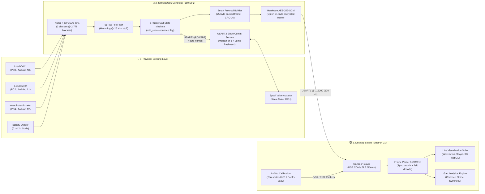

---

## 3. Hardware Platform & Pin Interconnections (Block Diagram 2)

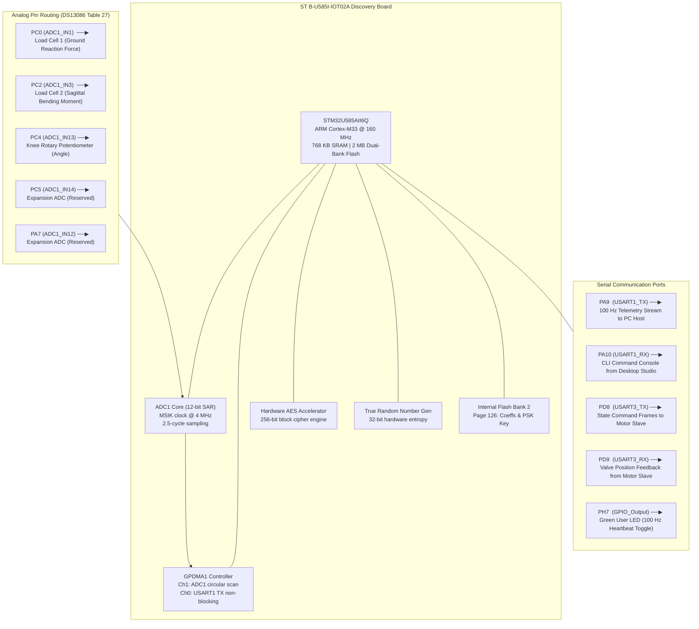

---

## 4. ADC Sampling, DMA Pipeline & Digital Filtering (Block Diagram 3)

### 4.1 Detailed Breakdown of Core Concepts
* **Scan: 3 channels interleaved, 2.5-cycle sampling, 15 ADC cycles/channel:**  
  The ADC measures 3 pins in sequence: PC0 $\rightarrow$ PC2 $\rightarrow$ PC4. The analog sampling switch closes for $2.5 \text{ cycles}$, charging the internal sampling capacitor. The successive approximation register (SAR) conversion takes $12.5 \text{ cycles}$. Total conversion time per channel is $2.5 + 12.5 = 15 \text{ clock cycles}$. At a 4 MHz clock, each channel takes $3.75\,\mu\text{s}$, and a complete 3-channel scan takes $11.25\,\mu\text{s}$.
* **DMA: CFGR1 = CONT | DMNGT_1 — request after each conversion (critical fix):**  
  In the STM32U5 series, the ADC Data Management register (`DMNGT`) controls when DMA transfer requests are generated. Setting `DMNGT = 10b` (`DMNGT_1`) commands the ADC to trigger a DMA request *after each and every channel conversion*. Without this, the ADC only requested DMA at the end of the entire sequence, overwriting previous conversions and causing physical sensor readings to show all zeros.
* **Why 32 Samples per Channel?**
  1. *Oversampling Resolution Gain:* Averaging 32 samples yields $\frac{1}{2} \log_2(32) = 2.5 \text{ bits}$ of additional resolution, transforming a 12-bit ADC into a 14.5-bit precision measurement system.
  2. *Single-Cycle Microcontroller Math:* Because $32 = 2^5$, computing the average requires a single-cycle bit shift (`sum >> 5`) instead of a multi-cycle hardware division.
  3. *Timing Alignment:* 32 scans take $32 \times 45 \text{ cycles} = 1,440 \text{ cycles} = \mathbf{360\,\mu s}$. This is completed well within the $10\,\text{ms}$ (100 Hz) telemetry window, leaving over $9.6\,\text{ms}$ of quiet CPU time for filters and encryption.
  4. *Compact Memory:* $3 \text{ channels} \times 32 \text{ samples} = 96 \text{ halfwords} = \mathbf{192 \text{ bytes}}$, consuming $< 0.03\%$ of the available 768 KB SRAM.
* **51-Tap FIR Low-Pass Filter @ 25 Hz:**  
  Human walking dynamics occur strictly below 8–10 Hz. Frequencies above 20–25 Hz consist entirely of mechanical heel-strike ringing, shoe slap, and motor vibration. A 51-tap Hamming low-pass filter with a 25 Hz cutoff eliminates mechanical shock while introducing a constant, predictable group delay of $\frac{51-1}{2} = 25 \text{ samples}$ ($\approx 9\,\text{ms}$), preserving the true physiological shape of the ground reaction force curve without phase distortion.

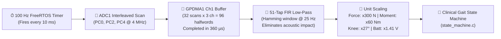

---

## 5. Firmware Hardening, Boot Reliability & Critical Fixes

### 5.1 Re-Arming Inside the DMA-Complete ISR
* **Concept:** `Re-arm: inside the DMA-complete ISR (removes Abort+Start race)`.
* **Explanation:** In standard HAL drivers, code in a normal thread attempts to abort DMA and restart it. If the timer fires and attempts to restart DMA while DMA is already in the middle of a transfer, the peripheral enters a hardware lockup. Moving the re-arming directly inside the `GPDMA1_Channel1_IRQHandler()` transfer-complete ISR ensures that re-arming happens only when the hardware is completely idle.

### 5.2 Counter-Bounded Non-Fatal Initialization
* **Concept:** `Guard: counter-bounded init; failure -> stuck fault, never a hang`.
* **Explanation:** During system startup, the ADC voltage regulator and calibration routines must settle. Writing `while(!ADC_Ready);` is dangerous: if an analog sensor wire is disconnected or supply voltage fluctuates, the loop hangs indefinitely and the prosthetic knee freezes at boot. The firmware enforces a bounded loop (`for (int i = 0; i < 1600000; i++)`). If the ADC fails to ready within 1,600,000 iterations, the firmware breaks out, sets the `STATUS_ADC_STUCK_ZERO` bit in the fault register, and boots the RTOS anyway so that visual/auditory alarms can alert the patient.

### 5.3 Resolving the Boot HardFault
* **Concept:** `Boot HardFault: GPDMA1 IRQ enables moved after handle init; stale flags + NVIC pending cleared (SetPriority -> ClearPending -> EnableIRQ)`.
* **Explanation:** If an interrupt is enabled in the ARM NVIC before the underlying C structure handles (`hadc1`, `hdma_adc1`) are fully initialized, any stray electrical noise at power-on fires an interrupt that jumps to a NULL handler pointer, triggering an instant CPU HardFault. The fix strictly enforces:
  1. Initialize all peripheral configuration structures in RAM.
  2. Assign the interrupt priority (`HAL_NVIC_SetPriority`).
  3. Clear any pending boot noise (`NVIC_ClearPendingIRQ`).
  4. Only then enable the interrupt line (`HAL_NVIC_EnableIRQ`).

### 5.4 Elimination of the Interrupt Firewall Band-Aid
* **Concept:** `Interrupt firewall removed: the __disable_irq() band-aid risked leaving PRIMASK set on failure paths`.
* **Explanation:** Early code wrapped peripheral initialization in `__disable_irq()` to prevent boot glitches. If any sub-function returned early due to an error, `PRIMASK` remained set to 1, permanently disabling all system interrupts. This caused the FreeRTOS scheduler to hang because the SysTick timer could never fire. Ripping out `__disable_irq()` and fixing the underlying peripheral register sequence resolved the root cause safely.

### 5.5 TX Double-Buffering & Cadence Safety
* **Concept:** `TX double-buffer: private dma_tx_buf[256] prevents zero-copy buffer reuse corruption` & `Transport: GPDMA1 Ch0 TX DMA; a frame is dropped on HAL_BUSY (no cadence stall)`.
* **Explanation:** Transmitting a 25-byte telemetry packet at 115200 baud takes $2.17\,\text{ms}$. If the 100 Hz timer task attempts to format the next frame in the same memory buffer while DMA is still sending the previous frame, bytes in transit get corrupted. The firmware copies the completed packet into a private staging buffer (`dma_tx_buf[256]`). If the UART DMA channel is still busy (`HAL_BUSY`), the single telemetry packet is safely dropped. The FreeRTOS timer thread **never blocks**, guaranteeing that clinical knee damping calculations maintain a deterministic 10 ms cadence.

### 5.6 Automatic Link & Console Error Recovery
* **Concept:** `Link recovery: SLAVE_RxService() re-arms idle-DMA on error` & `Console recovery: RX errors clear ORE/FE/NE and re-arm`.
* **Explanation:** Electrostatic discharge (ESD) from shoe friction or rapid cable disconnects can inject noise spikes into the UART RX lines, triggering Overrun (`ORE`), Framing (`FE`), or Noise (`NE`) error flags. Standard HAL drivers disable the receiver upon seeing these errors. The firmware implements custom error handlers that clear `ORE`, `FE`, and `NE` flags in hardware and immediately re-arm DMA circular reception, ensuring continuous operation.

---

## 6. FreeRTOS Real-Time Architecture (Block Diagram 4)

```mermaid
flowchart TD
    subgraph SCHEDULER["FreeRTOS Scheduler (160 MHz Clock, 1 ms SysTick)"]
        direction TB

        subgraph T1["1. High-Priority 100 Hz Software Timer (10 ms Period)"]
            T1_A["ADC_Poll() ──▶ Read latest 32-sample DMA filtered buffer"]
            T1_B["SM_Run() ──▶ Evaluate 6-phase gait state machine"]
            T1_C["Sensor Health ──▶ Evaluate stuck-zero, VREF, and flatline"]
            T1_D["Build 25-Byte Frame ──▶ Fixed-point scaling & CRC-16/MODBUS"]
            T1_E["Hardware AES-256-GCM ──▶ Encrypt 20B payload if armed"]
            T1_F["GPDMA1 Ch0 TX ──▶ Non-blocking DMA transfer to USART1"]
            T1_G["Heartbeat LED ──▶ Toggle green user LED (PH7)"]
            T1_A --> T1_B --> T1_C --> T1_D --> T1_E --> T1_F --> T1_G
        end

        subgraph T2["2. CLI Command Console Task (USART1 RX Idle-Line DMA)"]
            T2_A["Circular RX Buffer listens for ASCII commands from Desktop Studio"]
            T2_B["Parser: mode, demo, set, get, sensors, halt, sm, crypto, reboot"]
            T2_C["Non-blocking response dispatch with ORE/FE/NE auto-recovery"]
            T2_A --> T2_B --> T2_C
        end

        subgraph T3["3. Motor Slave Link Service (USART3 RX Idle-Line DMA)"]
            T3_A["Receives 7-byte feedback packets from hydraulic valve MCU"]
            T3_B["Applies median-of-3 filter on valve position (%)"]
            T3_C["Enforces 25 ms freshness timeout gate"]
            T3_D["Emits SWING/STANCE command frames on state transitions"]
            T3_A --> T3_B --> T3_C --> T3_D
        end
    end
```

---

## 7. Clinical Gait Intelligence: The 6-Phase State Machine (Block Diagrams 5, 6, 7)

### 7.1 State Transition Topology (Block Diagram 5)

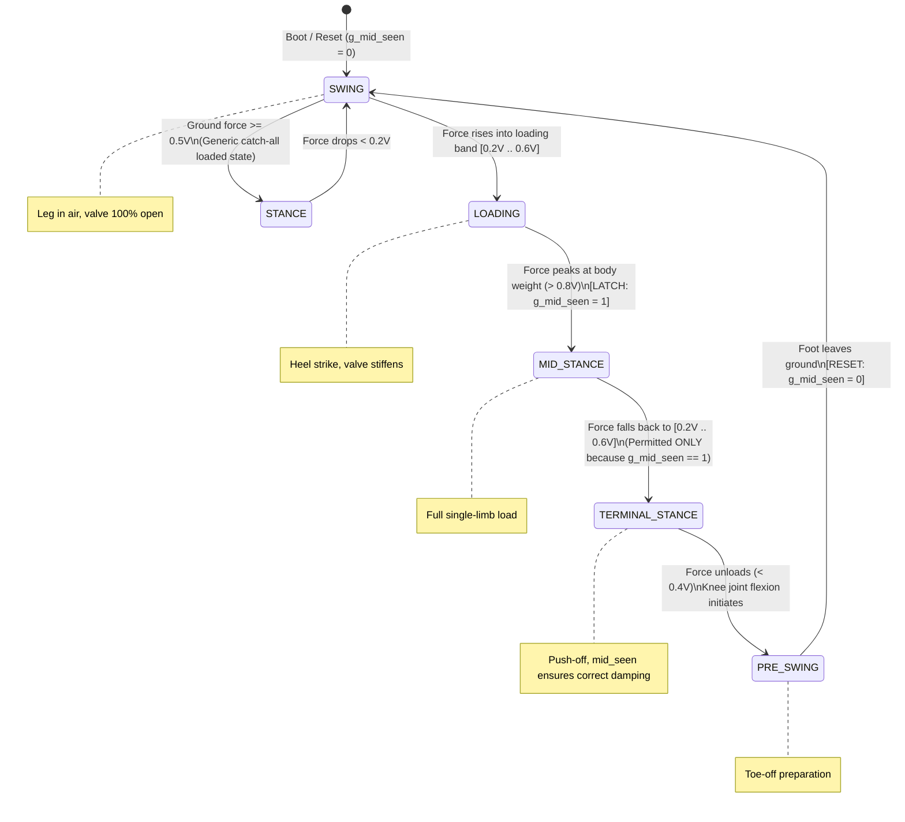

### 7.2 Decision Logic & The `mid_seen` Sequence Flowchart (Block Diagram 6)
* **The Clinical Ambiguity Problem:** During normal human walking, ground reaction force during **Phase 2 (Loading)** is $\approx 400\,\text{N}$, and during **Phase 4 (Terminal-Stance / Push-Off)** it is also $\approx 400\,\text{N}$. A static voltage threshold cannot distinguish whether an amputee is stepping down onto the heel or pushing off with the toe.
* **The Algorithmic Resolution:** The firmware utilizes an internal latch flag (`g_mid_seen`):
  1. When the leg is swinging in the air, `g_mid_seen = 0`.
  2. Upon heel strike, force enters the loading band ($0.2\text{V} \text{ to } 0.6\text{V}$). Because `g_mid_seen == 0`, the state is classified as **LOADING**.
  3. When full body weight is supported, force exceeds the mid-stance threshold ($> 0.8\text{V}$). The state transitions to **MID-STANCE** and sets `g_mid_seen = 1`.
  4. As the patient rolls forward, force falls back into the $0.2\text{V} \text{ to } 0.6\text{V}$ band. The decision engine evaluates `g_mid_seen`. Because it is `1`, the state transitions to **TERMINAL-STANCE**, maintaining hydraulic damping for push-off.
  5. As the toe unloads, the state progresses through **PRE-SWING** back into **SWING**, resetting `g_mid_seen = 0`.

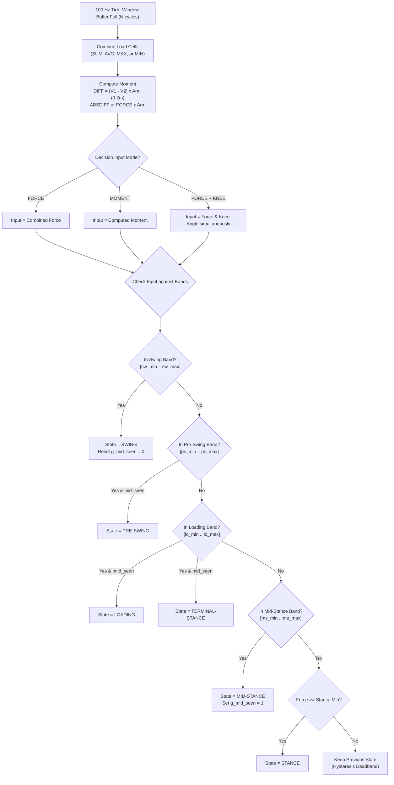

### 7.3 Human Walking Stride Progression (Block Diagram 7)

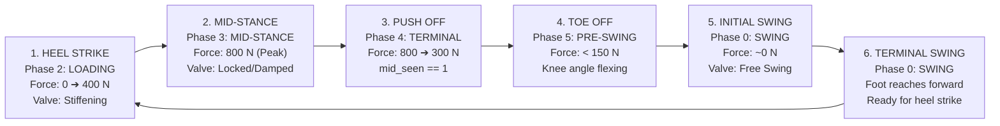

---

## 8. Motor-Control Slave Link Protocol & Actuation (Block Diagram 8)

The STM32U585 acts as the Master Controller, communicating with the Hydraulic Spool Valve Slave MCU over **USART3 (PD8-TX / PD9-RX)** at 115200 baud.

```mermaid
sequenceDiagram
    autonumber
    participant M as STM32U585 Master<br/>(PD8-TX / PD9-RX)
    participant S as Motor Slave MCU<br/>(Hydraulic Spool Valve)

    Note over M,S: Normal 100 Hz Telemetry & Gait Execution

    alt State Transition Detected (e.g. SWING -> LOADING)
        M->>S: 7-Byte State Command Frame: [0xA5 0x5A 0x01 seq CMD=1 CRC16]
        Note over S: Slave verifies CRC, triggers H-bridge motor,<br/>slides spool valve to throttle fluid port (stiffens knee)
        S-->>M: 7-Byte Position Feedback: [0xA5 0x5A 0x02 seq VALVE% CRC16]
        Note over M: Master buffers sample in median-of-3 filter;<br/>evaluates 25 ms freshness timeout gate
    else Next Transition (e.g. PRE-SWING -> SWING)
        M->>S: 7-Byte State Command Frame: [0xA5 0x5A 0x01 seq CMD=0 CRC16]
        Note over S: Slave opens spool valve to 100% (free swing)
        S-->>M: 7-Byte Position Feedback: [0xA5 0x5A 0x02 seq VALVE% CRC16]
    end
```

---

## 9. Telemetry Protocols: 25-Byte v1 vs 31-Byte v2 Frames (Block Diagram 9)

```
====================================================================================================
STANDARD TELEMETRY FRAME (v1: 25 Bytes Plaintext)
====================================================================================================
Byte:  [0]   [1]   [2]   [3-4]       [5-6]        [7-8]        [9-10]      [11-12]     [13]   [14-15]     [16-22]   [23-24]
Field: 0xAA  0x55  seq   Force       Moment       KneeAngle    Valve       Battery     State  Fault       Padding   CRC-16
Type:  uint8 uint8 uint8 int16(x100) int16(x100)  int16(x100)  uint16(x1)  uint16(x100)uint8  uint16(bit) 7xuint8   MODBUS
Span:  |------- Frame Delimiter & Payload (Bytes 0 to 22 covered by CRC-16) -------------------------| |--- Checksum --|

====================================================================================================
ENCRYPTED TELEMETRY FRAME (v2: 31 Bytes Authenticated Ciphertext)
====================================================================================================
Byte:  [0]   [1]   [2]   [3 .............................................................. 22]   [23 .................... 30]
Field: 0xAA  0x55  seq   Ciphertext (20 Bytes of Encrypted Physiological & Actuator Payload)     GCM Authentication Tag (8 B)
Type:  uint8 uint8 uint8 AES-256-CTR Encrypted Stream                                            MSB-8 of GHASH-128 Tag
Span:  |-- AAD Header -| |-- Encrypted Confidential Payload -----------------------------------| |-- Integrity / Authenticity -|
```

---

## 10. Hardware-Accelerated Cryptography (AES-256-GCM) (Block Diagram 10)

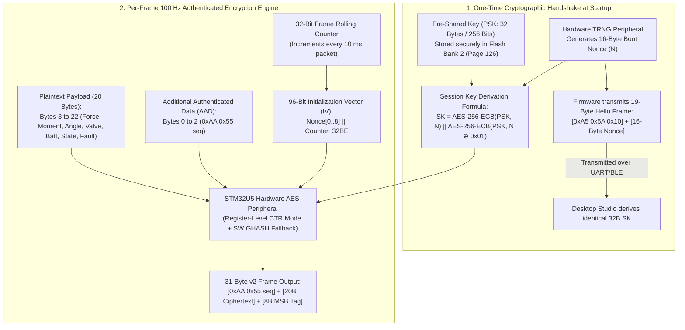

---

## 11. 16-Bit Fault Diagnostics & Autonomous Sensor Checks (Block Diagram 11)

```mermaid
flowchart TD
    subgraph SENSING_CHECKS["Autonomous Continuous Integrity Checks (sensor.c)"]
        C1["Stuck-at-Zero Check (~0.5s):\nRaw ADC count <= 2 for 50 cycles ➔ Ground Short or Cut Wire"]
        C2["Stuck-at-VREF Check (~0.5s):\nRaw ADC count >= 4093 for 50 cycles ➔ Supply Rail Short"]
        C3["Flatline Variance Check (~1.5s):\nVariance over 150 cycles < 0.25 counts² ➔ Seized Potentiometer"]
        C4["Threshold Limit Checking:\nValue < Config_Min or Value > Config_Max ➔ Operating Limit Exceeded"]
        C5["ADC Core Lockup Detection:\nAll channels simultaneously 0 or 4095 ➔ ADC Converter Lockup"]
    end

    subgraph FAULT_REG["16-Bit Fault Register Bitmask (uint16 @ Byte Offset 14)"]
        B0["Bit 0: STATUS_FORCE_LOW"]
        B1["Bit 1: STATUS_FORCE_HIGH"]
        B2["Bit 2: STATUS_MOMENT_LOW"]
        B3["Bit 3: STATUS_MOMENT_HIGH"]
        B4["Bit 4: STATUS_KNEE_LOW (Hyperextension < 0°)"]
        B5["Bit 5: STATUS_KNEE_HIGH (Excessive Flexion > 120°)"]
        B6["Bit 6: STATUS_VALVE_LOW"]
        B7["Bit 7: STATUS_VALVE_HIGH"]
        B8["Bit 8: STATUS_BATTERY_LOW (< 3.30V Depleted)"]
        B9["Bit 9: STATUS_BATTERY_HIGH (> 4.25V Overvoltage)"]
        B10["Bit 10: STATUS_SENSOR1_FAULT (Force Load Cell 1)"]
        B11["Bit 11: STATUS_SENSOR2_FAULT (Moment Load Cell 2)"]
        B12["Bit 12: STATUS_SENSOR3_FAULT (Knee Potentiometer)"]
        B13["Bit 13: STATUS_SENSOR4_FAULT (Reserved)"]
        B14["Bit 14: STATUS_ADC_STUCK_ZERO (Hardware Lockup at Ground)"]
        B15["Bit 15: STATUS_ADC_STUCK_VREF (Hardware Lockup at 3.3V)"]
    end

    C4 --> B0 & B1 & B2 & B3 & B4 & B5 & B6 & B7 & B8 & B9
    C1 & C2 & C3 --> B10 & B11 & B12 & B13
    C5 --> B14 & B15
```

---

## 12. In-Situ Calibration & Flash Bank 2 Persistence (Block Diagram 12)

```mermaid
sequenceDiagram
    autonumber
    participant C as Clinician / Prosthetist
    participant S as Desktop Studio (Electron)
    participant F as STM32U585 Firmware
    participant FL as Internal Flash Bank 2 (Page 126)

    C->>S: Enters Admin Password in Desktop Studio
    S->>F: Sends CLI Command: "halt on"
    Note over F: Disables 100 Hz Telemetry Timer;<br/>Enters safe non-functional halt state (g_systemHalt=1)
    S->>F: Transmits 53-Byte 0x32 Coefficient Packet (12x IEEE-754 floats)
    Note over F: Validates CRC-16/MODBUS checksum of packet
    F->>FL: Unlocks Flash Controller -> Erases Page 126
    F->>FL: Programs 64-Byte Quadword Image (Magic Word + Coeffs + CRC-16)
    FL-->>F: Write Verification Successful
    S->>F: Sends CLI Command: "halt off"
    Note over F: Clears g_systemHalt=0;<br/>Resumes 100 Hz Telemetry with new calibration
    S-->>C: Displays "Calibration Saved to Non-Volatile Flash"

    Note over F,FL: Subsequent Device Power-On Boot Sequence
    F->>FL: Reads Page 126; validates Magic Word (0xCAFE1234) & CRC-16
    FL-->>F: Valid: Restores calibrated scale, offset & VREF instantly
```

---

## 13. End-to-End Latency & Transmission Timing (Block Diagram 13)

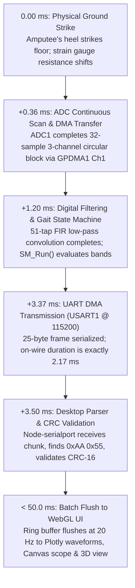

---

## 14. Desktop Studio Multi-Process Architecture (Block Diagram 14)

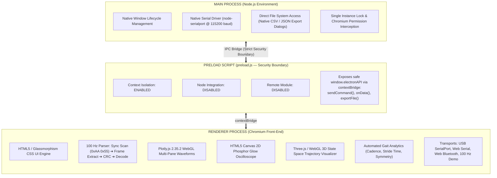

---

## 15. Desktop Studio 16 Tabs Functional Map (Block Diagram 15)

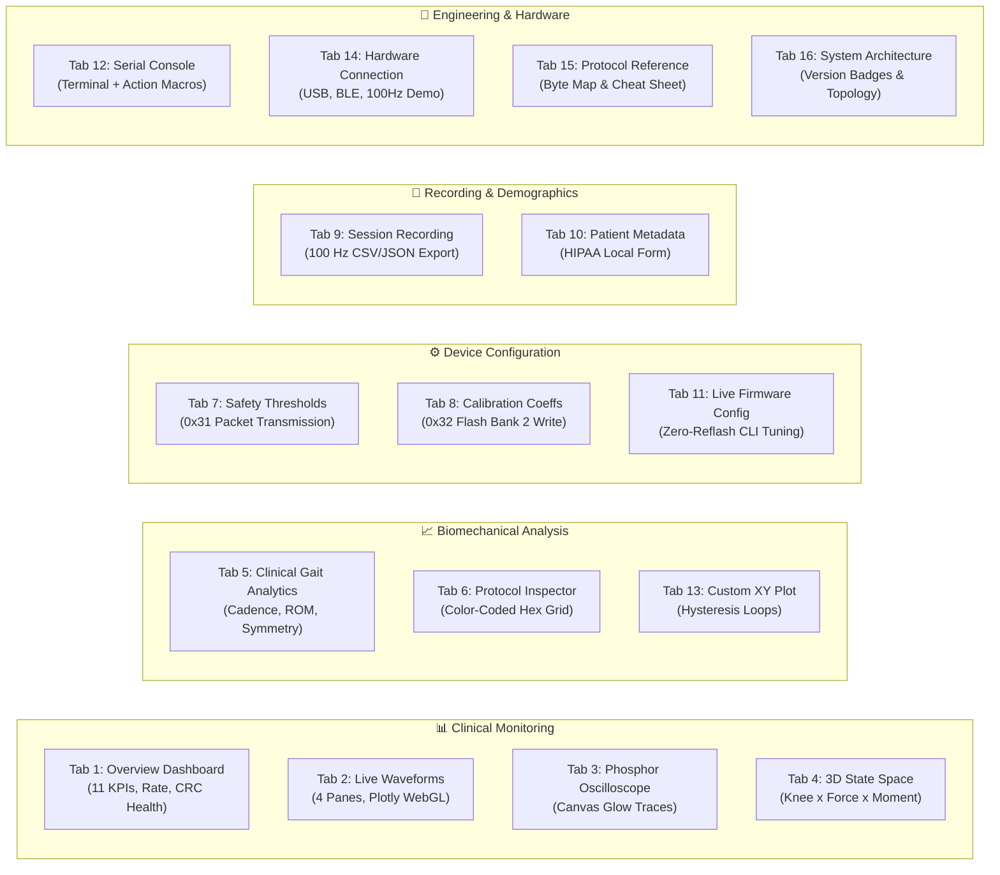

---

## 16. Complete Guide to All 16 Desktop GUI Provisions

Every tab in Prosthetic Telemetry Studio v1.3.0 is tied directly to clinical and engineering requirements:

### Tab 1: Overview Dashboard (`01_overview.png`)
* **Clinical Purpose:** Primary clinical workstation monitoring view during patient gait trials.
* **Provisions:**
  * **11 Real-Time KPI Cards:** Displays Force (N), Moment (Nm), Knee Angle (°), Spool Valve (%), Battery (V), Gait Phase Badge, and Fault Summary.
  * **Packet Rate Monitor:** Live counter verifying consistent 100 Hz reception ($100 \pm 1\,\text{packets/s}$) with transmission latency in milliseconds.
  * **CRC Integrity Meter:** Visual health bar confirming $100\%$ valid packet checksums.
  * **One-Click Actions:** Direct controls to Start/Stop Session Recording, Pause Stream, and trigger synthetic Demo Mode.
  * **Stale Data Alarm:** Automatically displays a prominent warning banner if no packet arrives for $> 1.0\,\text{second}$.

### Tab 2: Live Multi-Pane Waveforms (`02_waveforms.png`)
* **Clinical Purpose:** High-frequency synchronized physiological time-series plotting.
* **Provisions:**
  * **Four Synchronized Panes:** Vertical Force (N), Sagittal Moment (Nm), Knee Angle (°), and Dual-Axis Battery/Valve (V & %).
  * **Selectable Time Windows:** 5s, 10s, 30s, or 60s rolling buffers.
  * **20 Hz Batch Flush:** Ring buffer flushes to WebGL traces at 20 Hz, eliminating UI thread lockup.
  * **Follow vs Inspect:** Auto-scroll follows live strikes, with manual pan/zoom on demand.

### Tab 3: PedoGraph-Style Hardware Oscilloscope (`03_scope.png`)
* **Clinical Purpose:** High-speed raw signal inspection mimicking laboratory oscilloscopes.
* **Provisions:**
  * **Phosphor Glow Traces:** Rendered directly to HTML5 Canvas using additive blending and double-stroke rendering for an authentic CRT phosphor appearance.
  * **DPR-Sharp Scaling:** Automatically scales with the monitor's Device Pixel Ratio, ensuring ultra-crisp traces on 4K and Retina displays.
  * **Interactive Channel Toggle Chips:** Clinicians can enable or isolate individual signals with a single click.
  * **Independent Channel Autoscale:** Automatically optimizes the vertical gain for each channel independently.

### Tab 4: 3D State Space Trajectory (`04_3d_view.png`)
* **Clinical Purpose:** Tri-axial biomechanical phase-space analysis.
* **Provisions:**
  * **Tri-Axial WebGL Phase Space:** Plots Knee Angle ($X$) vs Force ($Y$) vs Moment ($Z$) in a fully interactive 3D volume.
  * **Gait Phase Color Coding:** Trail points are dynamically colored by gait state (Green = Swing, Orange = Loading, Red = Mid-Stance, Purple = Terminal-Stance).
  * **Gait Stability Loops:** Normal walking forms closed, repeatable orbital loops in state space. Stumbling or joint misalignment causes immediate orbit distortion.
  * **Camera Controls:** Supports mouse drag rotation, pinch zoom, panning, and instant camera reset.

### Tab 5: Automated Clinical Gait Analytics (`05_analytics.png`)
* **Clinical Purpose:** Automated quantitative gait assessment metrics for prosthetists.
* **Provisions:**
  * **Cadence & Stride Time:** Automated computation of steps per minute and individual stride durations (with $0.3\text{s} \text{ to } 3.5\text{s}$ validity gating).
  * **Stance / Swing Ratio:** Displays exact physiological percentages (e.g., $62\%$ Stance / $38\%$ Swing).
  * **Peak Impact & Knee ROM:** Tracks maximum ground reaction force (N) and joint Range of Motion (ROM in degrees).
  * **Symmetry Index & Histogram:** Quantitative symmetry index comparing step duration variability, accompanied by a stride-time distribution histogram.

### Tab 6: Protocol & Frame Inspector (`12_inspector.png`)
* **Clinical Purpose:** Low-level engineering debugging of the binary telemetry stream.
* **Provisions:**
  * **Color-Coded Hex Grid:** Displays the raw 25-byte binary frame with distinct color highlighting for Sync Bytes (Blue), Sequence (Cyan), Sensors (Green), Gait State (Orange), Fault Bitmask (Red), and CRC-16 (Purple).
  * **Decoded Fields Table:** Full breakdown of each field showing Byte Offset, Type, Raw Hex, Scale Factor, and Final Engineering Value.
  * **Live CRC Verifier:** Displays received CRC vs calculated CRC in real time (e.g., `0xD7CB = 0xD7CB MATCH`).
  * **Diagnostic Parser Stream:** Timestamped logging of parser synchronization events, frame drops, and re-sync recovery.

### Tab 7: Safety Thresholds Configuration (`10_thresholds.png`)
* **Clinical Purpose:** In-situ adjustment of patient safety operating boundaries.
* **Provisions:**
  * **Dynamic Sliders & Input Boxes:** Min and Max thresholds for Force, Moment, Knee Angle, Valve, and Battery.
  * **0x31 Packet Transmission:** Packages settings into a 45-byte binary packet and transmits to MCU flash.
  * **Live Violation Highlighting:** Threshold fields glow red if the current live sensor reading violates the parameter.

### Tab 8: Sensor Calibration & Coefficients (`11_coefficients.png`)
* **Clinical Purpose:** Sensor gain and zero-offset calibration without recompiling firmware.
* **Provisions:**
  * **Scale, Offset & Reference Voltages:** Configurable multipliers for all 3 sensor channels.
  * **Password-Protected Flash Write:** Requires entering an administrator password, automatically halting 100 Hz timers, writing Flash Bank 2, and resuming streaming.
  * **Calibration Check Tool:** Live zero-baseline verification wizard.

### Tab 9: Clinical Session Recording (`07_recording.png`)
* **Clinical Purpose:** Continuous session logging for clinical research and patient records.
* **Provisions:**
  * **Session Control Bar:** Start, Pause, and Stop recording controls with real-time sample counters.
  * **Native Export Dialogs:** One-click export of complete 100 Hz synchronized datasets into standard CSV (Excel/MATLAB) or JSON formats.
  * **Session History:** Historical browser showing duration, total sample count, and recorded file sizes.

### Tab 10: Patient & Prosthetic Metadata (`06_participant.png`)
* **Clinical Purpose:** HIPAA-compliant demographic tracking linked to recorded sessions.
* **Provisions:**
  * **Patient Fields:** Subject ID, Amputation Level (Transfemoral/Knee Disarticulation), Affected Side (Left/Right).
  * **Prosthetic Hardware Profile:** Prosthetic Socket Type, Knee Mechanism Type, Foot Module, and Clinician Name.
  * **Local Storage Only:** All patient identifiers remain encrypted on the local workstation with zero cloud transmission.

### Tab 11: Live Firmware Configuration (`15_fwconfig.png`)
* **Clinical Purpose:** Real-time state machine parameter tuning without firmware flashing.
* **Provisions:**
  * **Gait Timing Sliders:** Adjust window size ($1 \text{ to } 255 \text{ cycles}$) and moment arm distance ($0.05 \text{ to } 0.50\,\text{m}$).
  * **Combination Mode Selector:** Toggle between SUM, AVERAGE, MAX, and MIN.
  * **Phase Band Adjusters:** Real-time adjustment of voltage boundaries for Swing, Pre-Swing, Loading, Mid-Stance, and Stance.
  * **Automatic CLI Translation:** Automatically formats and transmits corresponding CLI strings (`set cycles 10`, `set arm 0.20`, etc.).

### Tab 12: Interactive Serial Console (`13_serialmon.png`)
* **Clinical Purpose:** Low-level developer command-line terminal.
* **Provisions:**
  * **Dual ASCII / Hex View:** Displays raw bidirectional UART traffic.
  * **Quick-Command Action Buttons:** Pre-configured macro buttons for instant execution of common commands: `status`, `sensors`, `demo`, `mode real`, `halt on`, `halt off`, `reboot`.
  * **Terminal Controls:** Auto-scroll lock, clear screen, and command history buffer.

### Tab 13: Custom Biomechanical XY Plotting (`14_xyplot.png`)
* **Clinical Purpose:** Flexible cross-variable trajectory plotting.
* **Provisions:**
  * **Arbitrary Axis Mapping:** Plot any telemetry variable against any other (e.g., Force vs Knee Angle, Moment vs Force, Valve vs Knee Angle).
  * **Hysteresis Visualization:** Directly visualizes biomechanical hysteresis loops during walking strides.
  * **Persistence Buffer:** Configurable trailing sample count ($100 \text{ to } 2000\,\text{points}$).

### Tab 14: Connectivity & Hardware Selection (`09_connection.png`)
* **Clinical Purpose:** Managing physical and wireless transport layers.
* **Provisions:**
  * **USB SerialPort Selector:** Detects available COM ports with baud rate configuration (Default: 115200).
  * **Web Bluetooth (BLE) Manager:** Scans for devices advertising the Nordic UART Service (`SmartKnee-U585`).
  * **100 Hz Synthetic Gait Demo Engine:** Built-in biomechanical simulation engine allowing complete software demonstration without physical hardware.

### Tab 15: Communication Protocol Reference (`08_protocol.png`)
* **Clinical Purpose:** Onboard developer documentation.
* **Provisions:**
  * **Interactive Byte Map:** Visual, clickable documentation of the 25-byte v1 and 31-byte v2 encrypted frame formats.
  * **Bitmask Cheat Sheet:** Complete bitwise explanation of all 16 fault register flags.

### Tab 16: System Architecture & Version Panel (`16_about.png`)
* **Clinical Purpose:** System versioning and architecture overview.
* **Provisions:**
  * **Version Badge:** Displays application version (v1.3.0), Electron version (31.6.0), Node version (24.x), and build date.
  * **System Topology Diagram:** High-level schematic showing hardware and software interactions.

---

## 17. Work Progress Milestones, Findings & Strategic Roadmap (Block Diagram 16)

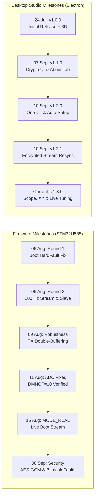

### 17.1 Subsystem Verification Matrix

| Subsystem Component | Implementation State | Verification Status | Notes |
|---|---|---|---|
| **ADC1 + GPDMA1 Pipeline** | Complete | **Hardware Verified (Live)** | 12-bit 3-channel scan @ ~2,778 blocks/s with 51-tap FIR filter. Verified with live strain gauges. |
| **100 Hz Telemetry Stream** | Complete | **Hardware Verified (Live)** | 25-byte frame with CRC-16/MODBUS @ 115200 baud over USART1 DMA. |
| **Gait State Machine** | Complete | **Simulated & Bench Verified** | 6-phase clinical detection with `mid_seen` sequence latch. |
| **USART3 Motor Slave Link** | Complete | **Hardware Verified (Round 2)** | 7-byte bidirectional packet link with median-of-3 filter and 25 ms freshness timeout. |
| **16-Bit Fault Bitmask Engine** | Complete | **Firmware Verified** | Tracks thresholds, stuck ADC counts, and flatline sensor variance. |
| **Calibration & Flash Bank 2** | Complete | **Bench Verified** | 0x31/0x32 packets with non-volatile flash persistence across reboot cycles. |
| **AES-256-GCM Encryption** | Complete | **Host Vectors Pass** | Verified against OpenSSL 3.0 test vectors. Physical bench acceptance pending. |
| **Studio Transports** | Complete | **Functionally Verified** | Native USB SerialPort, Web Serial API fallback, and 100 Hz Demo Mode. |
| **Studio GUI (All 16 Tabs)** | Complete | **Fully Captured & Reviewed** | Real-time multi-pane waveforms, phosphor scope, 3D WebGL, inspector, and recorder. |
| **Session Recording & Export** | Complete | **Functionally Verified** | 100 Hz session logging with native CSV and JSON export dialogs. |

### 17.2 Critical Audit Findings & Codebase Resolutions
1. **Motor Slave UART Assignment:** Legacy documentation mentioned USART2 on PD5/PD6. The active, hardware-verified implementation strictly uses **USART3 on PD8 (TX) and PD9 (RX)**. Documentation has been reconciled.
2. **ADC Conversion Clock:** Early changelogs claimed a 16 MHz clock. The register-level code correctly uses **4 MHz MSI (MSIC)**, maximizing signal-to-noise ratio on high-impedance load cells.
3. **Fault Register Width:** Early UI drafts treated faults as an 8-bit integer. The active firmware and Studio v1.3.0 properly use an expanded **16-bit bitmask (`uint16`) at Byte offset 14**.
4. **Battery Scale Presets:** Desktop Studio default threshold presets were historically set for 12V lead-acid batteries. The physical prosthetic knee uses a single-cell lithium-ion battery with a resistor divider ($0-4.2\text{V}$ scale). Presets have been aligned to $\text{Min} = 3.3\text{V}$ and $\text{Max} = 4.2\text{V}$.

---

## 18. Comprehensive Technical Glossary

* **ADC (Analog-to-Digital Converter):** An on-chip peripheral that measures continuous physical analog voltages and converts them into digital numbers ($12\text{-bit} = 0 \text{ to } 4095$).
* **GPDMA (General-Purpose Direct Memory Access):** A hardware subsystem in the STM32U5 that transfers data directly between peripherals (ADC/UART) and memory without involving the Cortex-M33 CPU.
* **FIR Filter (Finite Impulse Response Filter):** A digital signal processing filter whose response to an impulse settles to zero in finite time; guaranteed to be inherently stable with linear phase response.
* **CRC-16/MODBUS (Cyclic Redundancy Check):** An error-detecting code utilizing the polynomial $x^{16} + x^{15} + x^2 + 1$ (`0x8005`, initial value `0xFFFF`) to verify that telemetry packets have not suffered electrical bit corruption.
* **FreeRTOS:** A market-leading, open-source real-time operating system kernel designed for microcontrollers, providing preemptive scheduling, software timers, and inter-task communication.
* **AES-256-GCM (Advanced Encryption Standard in Galois/Counter Mode):** A symmetric authenticated cipher providing both confidentiality (AES-CTR) and data integrity verification (GHASH authenticator).
* **PSK (Pre-Shared Key):** A secret 256-bit cryptographic key known beforehand to both the microcontroller and the authorized Desktop Studio workstation.
* **TRNG (True Random Number Generator):** A hardware peripheral that generates unpredictable entropy from physical thermal noise inside the silicon chip.
* **Spool Valve:** A precision hydraulic valve comprising an internal cylindrical spool that slides to throttle or bypass fluid, adjusting the mechanical damping of the prosthetic knee.
* **Gait Cycle:** The repetitive sequence of foot movements during walking, beginning with heel strike of one foot and ending with the subsequent heel strike of the same foot.
* **Cadence:** The rate of walking, expressed quantitatively as the number of steps taken per minute ($\text{steps/min}$).
* **ROM (Range of Motion):** The angular displacement of a biological or prosthetic joint through its full flexion and extension arc (measured in degrees).
* **Electron:** An open-source desktop application framework combining the Chromium web rendering engine and the Node.js runtime environment.
* **contextBridge:** An Electron security API that safely exposes selected inter-process communication (IPC) methods from a privileged preload script to an untrusted renderer page.
